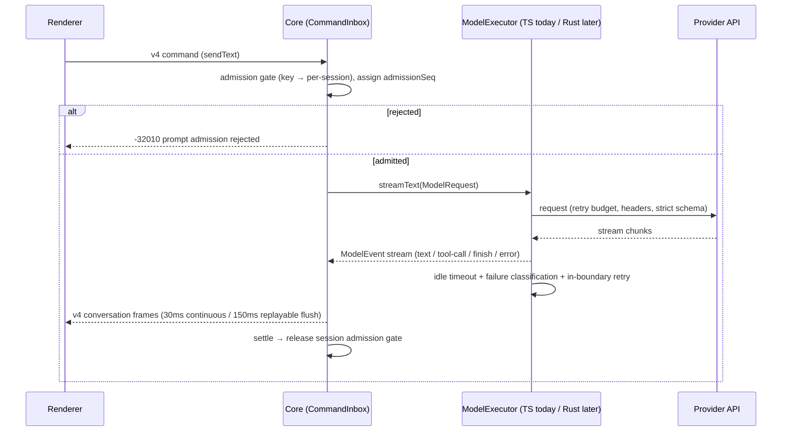

# Spec: Rust port — model provider execution boundary (CLI)

Owner: pending (CLI/runtime)
Status: draft for review (no code changes yet)
Date: 2026-09-22

## Background

Porting `apps/zcode-cli` to Rust (replacing the Node SEA build) requires drawing a
boundary around the model provider layer, because it is the only area fully locked to
a JS ecosystem (Vercel AI SDK + patched `@ai-sdk/anthropic` / `@ai-sdk/openai-compatible`).
Everything above this boundary (session, tools, workflow, protocol) is provider-neutral
and already expressed through `@zcode/contracts`.

This spec fixes the seam, the state owner, and the event order **before** any code is
written, so the TS implementation and a future Rust implementation can coexist behind
one contract without two sources of truth.

## Decisions

### D1. The seam is the existing `ModelExecutor` interface — no new interface

- File: `apps/zcode-cli/packages/adapters/src/model/model.ts`
- Contract types: `apps/zcode-cli/packages/contracts/src/model/` (`ModelRequest`,
  `ModelResult = ModelTextResult`, `ModelEvent = ModelStreamEvent`).
- Rule: `ModelExecutor.generateText()` / `streamText()` is the **only** surface that
  crosses the TS↔Rust boundary. Neither side may reach past it into AI SDK types
  (`TextStreamPart`, `LanguageModel`, `APICallError`) — those are implementation details
  of the current TS executor.
- Consequence: `runner-stream.ts` failure classification, idle-timeout, retry budget,
  and `strict-tool-schema.ts` folding rules are **part of the TS executor**, not part
  of the contract. A Rust executor must reproduce their observable behavior, not link
  to them.

### D2. State ownership — exactly one owner per state

| State                                                     | Owner                                                                | Not owned by             |
| --------------------------------------------------------- | -------------------------------------------------------------------- | ------------------------ |
| Prompt admission / busy-idle / turn serialization         | Core `CommandInbox` (`bootstrap/zcode-protocol-v4/command-inbox.ts`) | executor, renderer       |
| `admissionSeq` order for a session                        | Core `CommandInbox`                                                  | any transport            |
| In-flight stream (chunks, tool-call assembly, idle timer) | the `ModelExecutor` implementation handling that call                | Core, Host               |
| Retry decision for a single attempt                       | executor (`retry-policy`, `stream-idle-timeout`)                     | Core                     |
| Session/task rows, snapshots                              | Host storage worker (`node:sqlite` via `prepareTasksIndexStorage`)   | Main, renderer           |
| Unsubmitted draft, pending optimistic overlay             | Renderer                                                             | Host, CLI                |
| Protocol frames routing (topic fan-out, owner/lease)      | Window-scoped Host                                                   | Main, renderer, executor |

Rule: the Rust executor may own only "in-flight stream" and "retry decision". If it
needs admission or persistence, it must go through the existing Core/Host interfaces —
it must not open its own SQLite connection or gate turns itself.

### D3. Event order (must hold for both executors)

Invariants:

1. Admission happens **before** the executor is called; executor retries never
   re-enter admission (they are invisible above the seam except as status events).
2. `settle()` is called exactly once per admission, regardless of executor outcome.
3. Frame flush semantics stay per delivery profile: `continuous` (desktop, 30ms) vs
   `replayable` (web remote, 150ms). Changing the executor must not change either.

### D4. Behavioral parity requirements for a Rust executor

A Rust `ModelExecutor` is accepted only if it matches the TS executor on:

1. **Strict tool schema folding** — `strict-tool-schema.ts` rules (folded keyword
   descriptions, dropped unsupported constraints, `additionalProperties` handling,
   first-party vs third-party modelId detection).
2. **Video/media patch parity** — the repo patches `@ai-sdk/anthropic` and
   `@ai-sdk/openai-compatible` to emit `video/*` content blocks (`video` block for
   Anthropic-style, `video_url` data URL for OpenAI-compatible). The Rust
   implementation must emit byte-identical request bodies for the same input.
3. **Failure classification** — same mapping to `ModelErrorCode` / failure reason, so
   telemetry and `workflow-model-failure-policy` see identical outcomes.
4. **Retry semantics** — same retry budget, safe-prelude rules, empty-completion
   retry, idle-timeout values, and off-peak ticket expiry handling.
5. **Streaming tool-call assembly** — partial tool-call deltas assemble to the same
   final `toolCalls` payload (this is what `CommandInbox` settle depends on).

Acceptance: a golden-request corpus (captured via the existing `runner-debug` model-IO
recording, sanitized) replayed through both executors must produce identical request
bodies and identical `ModelEvent` sequences.

### D5. Transport is unchanged

The CLI process boundary stays stdio NDJSON (`ZCodeProtocolNdjsonConnection`,
`zcode-protocol` methods in `packages/shared/src/zcode-protocol/index.ts`) and v4
topic frames stay at `V4_WIRE_PROTOCOL_VERSION = 3`. A Rust CLI speaks the **same**
protocol; protocol changes are out of scope here and must follow the shared protocol
rule (strict types + runtime validation in `packages/shared/src/zcode-protocol/index.ts`).

## Non-goals

- No protocol version bump, no new wire format.
- No FFI/N-API call from TS into Rust for streaming (streaming crosses process
  boundaries only, never in-process FFI — avoids event-loop coupling).
- Not porting `packages/ui`, the TUI renderer, or Electron main.

## Acceptance scenarios

1. TS-only build behaves exactly as today (no regression from introducing the seam).
2. A Rust executor behind the same process protocol passes the golden parity corpus
   (D4.1–D4.5).
3. Kill/restart: executor crash mid-stream releases the session admission gate via
   the existing settle path; no stuck busy state (verifiable in both delivery profiles).
4. `pnpm typecheck` and `pnpm lint` pass on the TS side; Rust side has its own tests —
   both results reported honestly, no claimed pass without execution.
