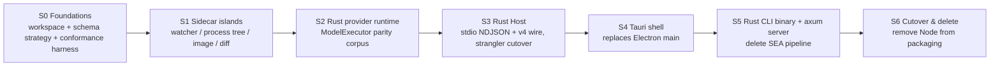

# Spec: Pure-native target architecture (Rust core + Tauri shell + webview UI)

Owner: pending (architecture)
Status: target confirmed; §7 recommendations decided 2026-09-22; S0–S5 executed 2026-09-22 (evidence in RUST-PORT-LOG.md ENTRY 005); S3 host integration executing 2026-09-22 (zcode-host, see specs/rust-native-crates.md); S5 wiring, S4 R4 BrowserView design gate and S6 cutover remain OPEN
Date: 2026-09-22

## Target (confirmed)

- **No Node/Electron runtime ships.** CLI, Host, services, server, and desktop shell
  are Rust. The React UI (`packages/ui`, ~304k lines) is **not rewritten** — it is
  served as static assets into a webview (Tauri/wry on desktop, Rust HTTP server for
  web/remote).
- **The provider layer is owned in Rust.** Streaming (SSE), tool-call assembly,
  retry/idle/off-peak policy, strict-schema folding, and the `video/*` request
  behavior currently implemented via patched `@ai-sdk/*` packages become first-class
  Rust code. No JS provider sidecar.
- Both answers are product decisions: they trade rewrite effort and permanent
  provider-compatibility ownership for a zero-JS-runtime distribution.

## Why this split (and not full native UI)

| Layer                                      | Technology     | Reason                                                                                                  |
| ------------------------------------------ | -------------- | ------------------------------------------------------------------------------------------------------- |
| Desktop shell, CLI, Host, services, server | Rust           | where code executes; kills SEA pipeline, Electron footprint, ABI matrix                                 |
| React UI + TUI components sharing web tech | webview/static | 304k lines + i18n/a11y/design-system investment; browser is the rendering engine, not a runtime we ship |
| User-side MCP servers / `npx` tools        | user's choice  | external processes; not our runtime, no purity violation                                                |

The renderer already accesses platform operations through `IPlatformService`
(`packages/shared/src/platform.ts`) and never calls `window.zcode` directly — this is
the porting seam for the shell swap: Tauri becomes one more `IPlatformService`
adapter, not a UI rewrite.

## Stages (each independently shippable and reversible)

### S0 — Foundations

- One cargo workspace (extend the model of `scripts/native-search-tools-*` and its
  `third-party/native-search` notice pipeline; do not invent a second one).
- **Schema strategy for coexistence**: while both stacks live, `packages/shared` zod
  schemas remain source of truth for TS; Rust mirrors them; **golden-vector fixtures
  (encode/decode/validate) are shared files, not derived per side**. Source of truth
  flips to Rust (serde + generated TS types) only at S3 exit.
- Protocol conformance harness replaying both delivery profiles:
  `desktop-continuous` (30ms flush) and `web-remote-replayable` (150ms flush).

### S1 — Native islands inside the current TS app (no behavior change)

- File watching (`fileWatcherService.ts`), process-tree termination/enumeration
  (replace `taskkill /T /F` + scraped lists with Job Objects), image codec (replace
  jimp), diff, workspace/storage scans.
- Delivered as **sidecar binaries over stdio**, not napi, to avoid re-introducing an
  ABI coupling class; TS keeps business ownership.
- Acceptance: golden tests byte-identical vs current outputs; both OS families green.

### S2 — Rust provider runtime

- Implement `ModelExecutor` semantics (`apps/zcode-cli/packages/adapters/src/model/`)
  in Rust behind the drafted seam (`specs/rust-cli-provider-boundary.md`):
  strict-tool-schema folding, `video/*` Anthropic/OpenAI-compatible request parity,
  failure classification to `ModelErrorCode`, retry budget/idle timeout/
  empty-completion/off-peak rules, streaming tool-call assembly.
- Acceptance: golden-request corpus (from `runner-debug` recordings, sanitized)
  produces identical request bodies and identical event sequences; admission/settle
  (`CommandInbox`) behavior unchanged.

### S3 — Rust Host (strangler, protocol-compatible)

- Rust host speaks the **existing** stdio NDJSON protocol and v4 wire
  (`V4_WIRE_PROTOCOL_VERSION = 3`, `PROTOCOL_V4_LIMITS`); `packages/shared` stays
  version owner during coexistence (`specs/rust-serialization-ffi-boundary.md`).
- Owns: session runtime, serial admission (`CommandInbox` semantics), storage
  (SQLite worker→Rust connection, single writer preserved), terminal
  (`portable-pty`), MCP client, frame routing/owner-lease.
- Cutover is **per workspace, behind a flag**, TS host and Rust host never both own
  a workspace. Rollback = flag off.
- Acceptance: both link semantics verified (AGENTS.md rule); session resume, fork,
  rewind, compaction, and busy/queue admission parity on real sessions.

### S4 — Tauri shell replaces Electron main

- Windows/tray/auto-update/deep links/notifications/crash capture reimplemented;
  renderer becomes static assets; `IPlatformService` gains the Tauri adapter.
- Electron-only integrations need replacements before committing to S4 — see §7.

### S5 — Rust CLI binary + axum server

- CLI replaces the SEA pipeline entirely (`build-sea.mjs`, postject, Node download,
  Authenticode strip, ad-hoc codesign all deleted). TUI moves to `ratatui`
  (React TUI layer is abandoned — it was web tech anyway).
- `packages/server` → axum; Docker base image stops being Node.

### S6 — Cutover & delete

- Remove Node from all packaging paths, `@ai-sdk` patches, SEA scripts, JS-only
  toolchain deps from the shipped artifact. TS remains only where it is rendered
  (UI source) or where tests still compare against frozen fixtures.

## Ownership rules (unchanged from AGENTS.md, re-stated for Rust)

1. One owner per state: Rust host owns session/task state; renderer owns drafts +
   optimistic overlay; shell (Tauri main) owns windows/native ops only.
2. Adding Rust creates no new frame owner — Host remains the only router.
3. `workspaceIdentity?.trim() || workspacePath` remains the identity key everywhere,
   including new Rust code.
4. Busy/running input stays serially admitted in one place (Rust `CommandInbox`
   after S3); renderer never gates.

## Non-goals

- Rewriting `packages/ui` in native Rust GUI.
- Binary wire format change (JSON/NDJSON stays until a measured need).
- Embedding any JS engine in shipped binaries (plugins/`node_repl` go
  out-of-process/external per §7 R1–R2).

## Risks

- **Provider drift is now permanent work** (confirmed accepted): every provider API
  change (Anthropic/OpenAI-compatible) is yours; mitigated by the parity corpus +
  recorded fixtures as the regression net.
- **Long dual-stack period**: TS and Rust hosts coexist from S2→S6; the conformance
  harness is the only thing preventing divergence — it must run in CI from S0.
- **Tauri parity gap** (S4) is the highest-uncertainty stage: auto-update, Windows
  App-Bound Key credentials, telemetry agent, CUA panels, BrowserView-class embeds.
- **Plugin/browser JS surface** (S3): now decided as R3/R1 below — residual risk is
  Playwright→CDP auto-wait regression, mitigated by the golden e2e gate.
- **Team skill shift**: Rust review velocity < TS initially; stage gates are sized so
  stopping after any stage leaves a shippable product.

## §7. Decided recommendations (2026-09-22 — execute these)

Grounding facts: `node-repl-host`'s manifest says it "owns the JS execution surface
and the domain bridges (Browser Use, Computer Use)" — it _is_ the plugin runtime and
already an MCP server; `adapters/browser` is already Chromium-only
(`BrowserType<ChromiumBrowser>`, descriptor `type: "cdp"`); `chromeCredentialManager`
unwraps Chrome's DPAPI key via encoded PowerShell; CUA ships disabled (fail-closed).

### R1. Plugin runtime → Rust MCP host process; plugins are out-of-process (was #1)

- Rewrite `node-repl-host` host/bridges (process-lifecycle, cua-broker,
  browser-bridge, runtime-bridge, tool-contract) as a **Rust MCP server**; plugins
  become processes speaking MCP/stdio — formalizes what the architecture already is.
- **No embedded JS engine** (no quickjs/boa, no deno_core/V8). Third-party JS
  plugins run in the **user's** Node as external processes — the same contract MCP
  `npx` servers already make; the shipped app contains no JS runtime.
- Pros: purity holds; crash isolation; language-agnostic plugin future; reuses MCP
  machinery you own. Cons accepted: IPC overhead per plugin call, plugin API must
  be a versioned protocol rather than in-process imports.
- **Acceptance**: browser-use + official skills work against the Rust host; plugin
  kill/restart cannot take down Host; a JS plugin on a Node-less machine fails
  closed with a typed "runtime unavailable" error, never partially.

### R2. `node_repl` evaluation → external Node, capability-detected, fail-closed (was #2)

- Tool detects user-provided Node at startup; absent → reports **unavailable** —
  the exact fail-closed pattern `zcode-cua` already uses. Nothing embeds an engine;
  when Node exists, semantics are real Node (require/npm/fetch/fs identical today).
- Rejected: quickjs embed (semantic drift breaks model-written snippets
  confusingly), deno_core embed (ships ~40MB V8 — violates "no JS runtime ships"),
  Rust rewrite of eval (breaks shipping JS skills).
- Pros: zero maintenance, honest semantics, consistent with repo fail-closed
  philosophy. Cons accepted: feature availability varies by machine; dependent
  skills must handle explicit unavailability.
- **Acceptance**: `node_repl`-dependent skills green on a Node machine; on a
  Node-less machine the tool is omitted/reported unavailable and dependent skills
  degrade explicitly (documented, never silent).

### R3. Browser automation → raw CDP client, Chromium-only (was #3)

- Replace `playwright-core` with a Rust CDP client (thin hand-rolled or
  `chromiumoxide`): managed launch, existing system-Chrome/Chromium discovery,
  snapshot via `Accessibility.getFullAXTree` (≡ `snapshot.ts`), page commands,
  screenshots.
- **Gate: golden e2e suite first.** Existing browser-use flows run against
  Playwright as reference; the CDP client must pass the same suite before Playwright
  is deleted. Auto-wait/stability (Playwright's silent magic) is the named risk —
  it must be re-implemented and _proven by the suite_, not assumed.
- Pros: kills the biggest JS dep in `adapters` + its browser downloads; Chromium-only
  matches what you actually use; `launchMode: "managed"` maps 1:1. Cons accepted:
  you own auto-wait reimplementation, CDP version drift, no locator engine/trace
  viewer; Firefox/WebKit never supported (no loss — never claimed).
- **Acceptance**: golden browser-use e2e green on CDP across the OS matrix;
  `playwright-core` absent from the shipped artifact at S6.

### R4. Electron integrations → triage buckets, one design gate (was #4)

| Bucket                     | Items                                                                                                                                | Rule                                                                                                            |
| -------------------------- | ------------------------------------------------------------------------------------------------------------------------------------ | --------------------------------------------------------------------------------------------------------------- |
| **Rewrite (Rust upgrade)** | Chrome DPAPI/App-Bound credential discovery                                                                                          | Native `windows` crate DPAPI replaces encoded-PowerShell unwrap — safer than today, not merely equivalent       |
| **Tauri plugins + port**   | tray, deep links, notifications, menu, window chrome, Linux XDG/AppImage, macOS close behavior, auto-update (`tauri-plugin-updater`) | Port policy logic (`forceUpdateGuard`, prompt rules); re-validate all three OS signing paths before cutover     |
| **Replace with OTLP**      | `@arms/rum-electron` telemetry                                                                                                       | Consolidate onto existing OTLP/agent-trace pipeline; audit ARMS-only features first, record accepted losses     |
| **Defer**                  | CUA helper install, PiP, permission panels                                                                                           | CUA ships disabled today; decide only when CUA returns                                                          |
| **Design gate before S4**  | `BrowserView` / `UnifiedBrowserView` embed                                                                                           | Tauri has no BrowserView: child-window vs CDP-composite is a product/UX decision — resolve **before S4 starts** |

- Pros: ~60% is mechanical plugin-grade work; credentials and telemetry actually
  improve; CUA deferral exploits its already-disabled state. Cons accepted:
  auto-update is high-blast-radius; BrowserView may change product UX.
- **Acceptance**: feature-audit table (Electron-era feature → replaced / accepted
  loss / deferred) fully filled before S4 exit — no silent losses; any non-"replaced"
  row needs an explicit recorded acceptance.

## Acceptance for the target as a whole

1. Shipped installers contain no `node`, no Electron, no SEA artifact; size and
   cold-start budgets recorded before/after.
2. Conformance harness green for both delivery profiles across TS↔Rust coexistence
   and after TS host removal.
3. Provider parity corpus green at S2 and re-run as CI regression forever.
4. Feature audit: every Electron-era feature is either replaced or explicitly
   accepted as removed (§7 R4 table filled, no silent losses).
5. `pnpm typecheck` / `pnpm lint` reported honestly for the remaining TS; Rust side
   reports its own test results — no pass claimed without execution.
