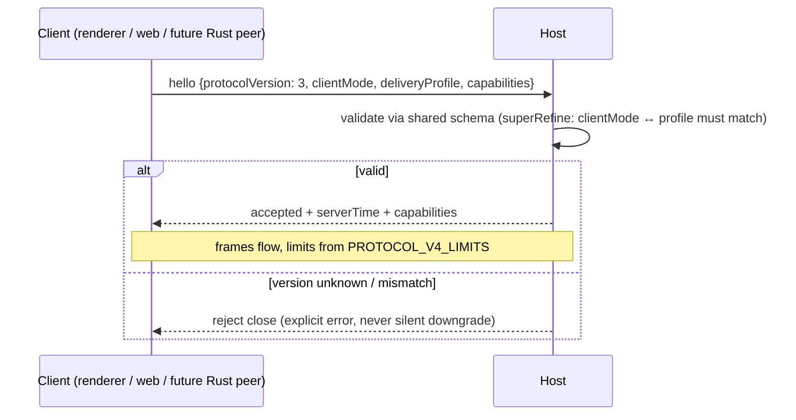

# Spec: Rust port — serialization / FFI boundary and protocol versioning

Owner: pending (rpc/shared/host)
Status: draft for review (no code changes yet)
Date: 2026-09-22

## Background

Two serialization layers exist today and both would sit on a future TS↔Rust boundary:

1. **RPC Layer 1** (`packages/rpc/src/serialization.ts`): 1-byte type tag + VQL length
   - payload; `Object` values fall back to JSON with a nested `Uint8Array` marker
     (`__zcode_rpc_nested_uint8array_v1`). Used by ChannelClient/ChannelServer/ipc.
2. **Protocol v4 wire** (`packages/shared/src/zcode-protocol-v4/`):
   `V4_WIRE_PROTOCOL_VERSION = 3`, JSON logical frames with CRC32/base64 in
   `wire-binary.ts`, size limits in `PROTOCOL_V4_LIMITS`, `hello` handshake with
   `clientMode: desktop-continuous | web-remote-replayable`.

Plus the CLI stdio NDJSON protocol (`packages/shared/src/zcode-protocol/index.ts`).

This spec decides what crosses the boundary and how versions coexist, so we do not end
up with two incompatible encodings or two owners for the same frames.

## Decisions

### D1. Boundary encoding is the existing NDJSON/v4 wire — not a new binary format

- Rule: anything crossing a **process** boundary (Host ↔ CLI, Host ↔ renderer,
  Host ↔ mobile relay, future TS ↔ Rust) uses the existing stdio NDJSON protocol and
  v4 topic frames unchanged.
- The RPC Layer 1 tag+VQL format stays **in-process TS only** (MessagePort/IPC inside
  the Electron app). It is not exported to Rust; a Rust component never links against
  `serialize()/deserialize()`.
- Rationale: switching Layer 1 or v4 to msgpack/CBOR is a breaking change across
  Desktop/Web/CLI/relay with no owner today; it is explicitly deferred (see Non-goals).

### D2. State ownership

| State                                                           | Owner                                                                              |
| --------------------------------------------------------------- | ---------------------------------------------------------------------------------- |
| `V4_WIRE_PROTOCOL_VERSION` constant and `PROTOCOL_V4_LIMITS`    | `packages/shared` (single source)                                                  |
| `zcodeProtocolMethods` + runtime validation schemas             | `packages/shared/src/zcode-protocol/index.ts`                                      |
| Frame routing, topic fan-out, owner/lease, stale-run protection | window-scoped Local Host                                                           |
| Connection handshake (hello, capabilities, delivery profile)    | Host (server side) / client (dialer side), validated by shared schemas             |
| Message queue for accepted busy/running input                   | CLI/runtime `CommandInbox` (single writer)                                         |
| Renderer state                                                  | drafts + pending optimistic overlay only                                           |
| Main process                                                    | windows, native ops, process spawn/forwarding — **no** task/session business state |

Rule: adding a Rust process does not create a new frame owner. The Host remains the
only router; a Rust component is either behind an existing owner (e.g. executor under
Core) or replaces a whole process speaking the same protocol.

### D3. Version negotiation and mixed-version safety

1. Version mismatch fails **closed** with an explicit error — no silent downgrade,
   no best-effort decoding (matches the existing strict `.strict()` schemas).
2. `clientMode` and `deliveryProfile` must agree
   (`desktop-continuous` ↔ `continuous`, `web-remote-replayable` ↔ `replayable`);
   the Host must verify both link semantics when stream/snapshot/queue/reconnect code
   changes.
3. A future Rust peer presents the same hello payload; there is no separate
   Rust-specific handshake.

### D4. Both links must be verified whenever this boundary changes

- `desktop-continuous`: real-time stream, 30ms flush, desktop-only rows allowed.
- `web-remote-replayable`: snapshot + replay, 150ms flush, tool progress allowed.
- Acceptance for any change in this area requires exercising **both** semantics, not
  just the local desktop path.

## Non-goals (deferred, needs separate alignment)

- Replacing JSON/msgpack for Layer 1 or v4 frames (breaking, three-end rollout).
- Moving SQLite ownership from the Host storage worker into Rust.
- Binary hello/capability negotiation beyond the current schema.

## Acceptance scenarios

1. Golden-vector tests: fixtures encoded by the current TS serializer decode to the
   same values under any future Rust peer implementation of the same format (kept as
   shared fixtures, not re-derived per side).
2. Unknown `protocolVersion` → connection rejected with a typed error on both links.
3. `clientMode`/`deliveryProfile` mismatch → rejected by schema `superRefine`.
4. Mixed rollout: old TS client against new Host (and vice versa) either handshakes
   or fails closed — never partially decodes frames.
5. `bun run typecheck` and `bun run lint` executed and reported on the TS side.
